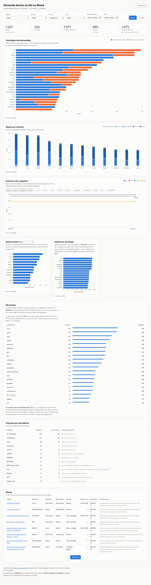
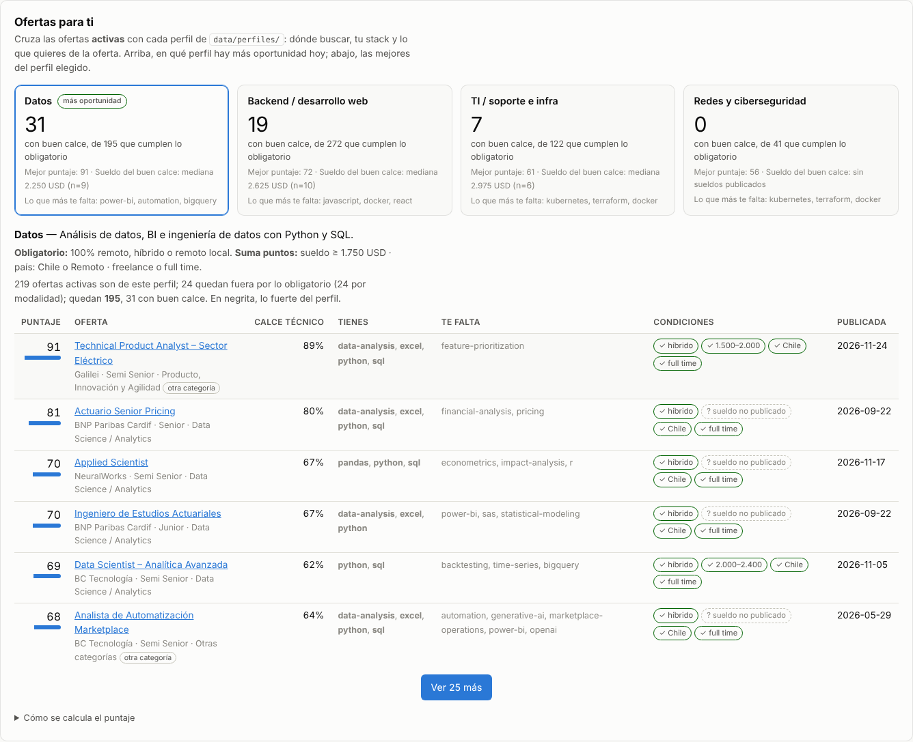

# Dashboard de demanda técnica — Get on Board

Aplicación local que consume la **API pública** de [Get on Board](https://www.getonbrd.com),
guarda las ofertas en SQLite y sirve un dashboard para responder qué se está demandando hoy en el
mercado tech LATAM/Chile:

- ¿Qué tecnologías aparecen en más ofertas activas?
- ¿Cómo se reparten por seniority, modalidad remota y país?
- ¿Qué stacks aparecen juntos?
- ¿Qué está creciendo o cayendo entre snapshots?
- ¿Qué empresas publican más y con qué stack?
- **Brechas**: dado mi stack actual, qué tecnologías me faltan y cuánto me abriría cada una.
- **Ofertas para ti**: con varios perfiles de búsqueda (TI, redes, datos, backend…), en cuál hay
  más oportunidad hoy y qué ofertas calzan mejor con mi stack y con lo que pido de la oferta.

> Solo API pública, nada de scraping del HTML del sitio. Sin credenciales: la API pública no las
> necesita, así que el repo no tiene `.env` ni secretos.



<details>
<summary>En modo oscuro</summary>


Los tonos oscuros no son una inversión de los claros: son pasos elegidos para el fondo oscuro y
validados contra él.
</details>

## Instalación

```bash
python -m venv .venv
.venv\Scripts\activate          # Windows;  source .venv/bin/activate en Linux/macOS
pip install -r requirements.txt
pip install -e .                # deja `python -m gob.ingest` disponible
```

Requiere Python 3.11+ (probado con 3.13.1).

## Uso

```bash
# 1. Poblar la BD: recorre las 18 categorías y escribe data/gob.db
python -m gob.ingest --full

# 2. Levantar el dashboard en http://127.0.0.1:8000
uvicorn gob.web:app --reload
```

Eso es todo. Una corrida completa son **1.022 ofertas** de 18 categorías, 224 empresas y 10.601
asignaciones de tag (8.394 oficiales + 2.207 sacadas del texto de la oferta), en **~45 s** y 23
peticiones.

Otros comandos:

```bash
# Solo algunas categorías
python -m gob.ingest --categories programacion,sysadmin-devops-qa

# Reprocesar sin volver a llamar a la API (usa el JSON crudo de data/raw/)
python -m gob.ingest --from-cache

# Reaplicar data/tag_aliases.yml después de editarlo, sin reingestar
python -m gob.ingest --refresh-aliases

# Ver el análisis por consola, sin dashboard
python scripts/reporte.py --tag python --categoria programacion

# Congelar el dashboard en un solo HTML que se abre sin servidor -> dist/dashboard.html
python scripts/exportar_estatico.py
```

### Verlo sin servidor

`scripts/exportar_estatico.py` deja el dashboard en **un solo archivo HTML** (~1,7 MB con 967
ofertas activas) que se abre en cualquier navegador, también en el teléfono, sin uvicorn. Le pide
cada ruta a la app real y guarda las respuestas dentro de la página; un `fetch` de reemplazo
([`static/estatico.js`](static/estatico.js)) contesta desde ahí, así que es el mismo dashboard
con los mismos números. Se puede abrir tal cual, subir a un hosting estático o publicar como
página. La barra de filtros no existe en esta versión: todas las cifras van sin filtrar.

Opciones útiles de la ingesta: `--db RUTA`, `--sandbox`, `--per-page N` (máx. 120), `--rate N`
(peticiones por segundo, 2 por defecto), `--lang es|en|pt`, `-v`.

**Cada corrida es idempotente**: el upsert va por `id` de oferta y conserva `first_seen_at`.
Correrla dos veces deja exactamente las mismas filas, solo avanza `last_seen_at` y añade un
snapshot.

**Cada página se guarda en disco antes de tocar la BD** (`data/raw/<corrida>/<categoria>_pN.json`),
así que si la ingesta muere a mitad no se pierde lo descargado y `--from-cache` lo reconstruye.
Cada corrida ocupa ~9 MB; las carpetas viejas de `data/raw/` se pueden borrar a mano.

## El dashboard

Una sola página, sin build step: Jinja2 + Chart.js por CDN. **No llama a la API en tiempo de
request**: lee la BD entera en memoria y la recarga sola cuando el archivo cambia, así una
reingesta se ve sin reiniciar el servidor.

| Panel | Qué contesta |
|---|---|
| Ofertas para ti | en qué perfil de búsqueda hay más oportunidad y qué ofertas **activas** calzan mejor con cada uno |
| Barra de filtros | categoría, seniority, remoto, país y rango de fechas; se aplican a todo lo demás |
| KPIs | ofertas, empresas, tecnologías, % remoto y mediana de sueldo con su cobertura |
| Top 25 tecnologías | barras apiladas que separan el **tag oficial** de lo **deducido del texto** |
| Reparto por seniority | a qué nivel se pide cada tecnología |
| Evolución entre snapshots | hasta 5 tecnologías a elegir; avisa si no hay histórico suficiente |
| Co-ocurrencia | con qué aparece una tecnología, con conteo y **lift** |
| Sueldos | mediana, p25 y p75 por tecnología, con el *n* siempre a la vista |
| Mis brechas | lo que se pide y no tengo, por volumen y afinidad |
| Empresas | quién publica más y con qué stack |
| Ofertas | tabla filtrada con enlace a la oferta original |

Cada gráfico trae su **tabla alterna** (`Ver como tabla`) y modo claro/oscuro con conmutador.
La paleta está validada con el validador de la guía de dataviz (banda de luminosidad, suelo de
croma, separación para daltonismo y contraste), en ambos modos.

### Sobre el panel de brechas

El diseño original —ordenar por "ofertas que se desbloquean del todo"— no sobrevive a los datos
reales: una oferta pide **10,4 tags de media**, entre ellos cosas como `documentation` o
`team-leadership`. Es una carta a los Reyes, no un checklist. Con un stack de 10 tecnologías
ninguna oferta pasa del 60% de cobertura y "solo me falta esto" da **1 caso en 1.022**.

Así que ordena por **volumen** y acompaña con la **afinidad**: qué porcentaje del resto de esas
ofertas ya cubres. Es lo que separa "lo piden muchos y estás cerca" de "lo piden muchos pero es
otro mundo" — con el mismo volumen, `jira` (10%) y `typescript` (19%) no significan lo mismo.

### Sobre la sección de perfiles

Uno no busca trabajo de una sola cosa. Cada archivo de [`data/perfiles/`](data/perfiles/) es un
perfil de búsqueda con cuatro partes:

- **Dónde buscar**: `categorias` de Get on Board, más `tambien_si_pide`, una lista de tags que
  hacen entrar ofertas de otras categorías.
- **Tu stack**: `mi_stack.yml` más lo `fuerte` del perfil, que pesa doble.
- **Lo que quieres de la oferta**: modalidad remota, sueldo mínimo, país y jornada. Cada
  condición es **obligatoria** (descarta) o **deseable** (suma puntos).
- **Descripción**: el nombre y una línea para la UI.

La sección compara primero los perfiles entre sí: cuántas ofertas con **buen calce** (cubres al
menos la mitad de lo que piden) tiene cada uno, su mejor puntaje, la mediana de sueldo de esas
ofertas y lo que más falta entre tus 20 mejores calces. Debajo va el ranking del perfil elegido,
con lo que tienes, lo que te falta y cada condición marcada como ✓, ✗ o ? (no publicado).



**Solo mira ofertas activas**, las de la última corrida de la ingesta. La BD conserva todo lo que
vio alguna vez (lo necesita para las tendencias), y en nov-2026 eso eran 1.785 ofertas de las
que solo 967 seguían publicadas.

La fórmula salió de probarla contra los datos reales, no de un diseño previo:

- **Categorías + `tambien_si_pide`, no solo categorías.** Get on Board no tiene categoría de
  redes: los puestos de redes y telecom aparecen repartidos en 8 categorías.
- **`tambien_si_pide` explícito, no "cualquier oferta que pida 2 de tus fuertes".** Así se
  probó primero, pero Python y SQL los pide medio mercado: el perfil de backend se llenaba de
  ofertas de datos y el de TI de desarrolladores Siebel.
- **Lo deducido del texto pesa la mitad.** La extracción por keywords también caza lo que la
  oferta menciona como deseable, no como requisito.
- **Denominador mínimo de 5.** Sin eso, una oferta que solo pide `python` calzaba al 100%.
- **Las condiciones sin dato no descartan.** El 62% de las ofertas no publica sueldo: un sueldo
  mínimo obligatorio que las tirara dejaría el ranking casi vacío.

Con el stack y los perfiles de ejemplo, en nov-2026 salían 31 ofertas con buen calce en datos,
19 en backend, 7 en TI y 0 en redes, donde 22 de las 63 candidatas eran presenciales.

## Los ficheros que puedes editar a mano

| Archivo | Para qué |
|---|---|
| [`data/mi_stack.yml`](data/mi_stack.yml) | Tu stack actual, para el panel de brechas y como base de cada perfil |
| [`data/perfiles/*.yml`](data/perfiles/) | Un perfil de búsqueda por archivo: dónde buscar, lo fuerte y qué pides de la oferta. Se releen solos; uno con errores sale como aviso sin tumbar al resto. Los que empiezan con `_` se ignoran |
| [`data/tag_aliases.yml`](data/tag_aliases.yml) | Agrupar duplicados semánticos (`angularjs` → `angular`, `net` → `dotnet`) y puentear del castellano al slug de la API. Tras editarlo: `--refresh-aliases` |
| [`data/tech_keywords.yml`](data/tech_keywords.yml) | Tecnologías a buscar en el texto de la oferta, para lo que los tags oficiales no cubren (SCADA, Modbus, Airflow…). Tras editarlo hay que reprocesar: `--from-cache` |

Si algo de tu stack aparece en "sin demanda aquí", suele ser una de dos: el mercado no lo pide, o
el nombre no casa con ningún tag. Lo segundo se arregla con un alias.

## Tests

```bash
pytest -q          # 240 tests, ~3 s
```

Con fixtures fijas y **sin salir a internet**: `tests/conftest.py` bloquea la resolución de nombres
y las conexiones a hosts externos, así que un test que intente llamar a la API falla en el acto con
un mensaje claro. Los del cliente HTTP usan `httpx.MockTransport`; los del dashboard, `TestClient`.

## La API

**Lee [`docs/API.md`](docs/API.md) antes de tocar el cliente.** Documenta el esquema *real*
observado con llamadas en vivo, no el del OpenAPI, incluyendo las trampas que cuestan tiempo:
`page`/`expand[]` funcionan aunque no estén documentados, `expand` mal escrito devuelve **500**,
los ids colapsados y expandidos son distintos, y `search/jobs` no sirve como catálogo.

Las respuestas de ejemplo están en [`docs/api-samples/`](docs/api-samples/) y se regeneran con
`python scripts/fetch_samples.py`.

## Límites conocidos

- **Sin moneda**: la API no expone ninguna, en ningún endpoint. Los sueldos se guardan como `USD`
  brutos/mes por convención de Get on Board, y tanto la UI como los docs lo marcan como supuesto.
  Solo el 42% de las ofertas publican rango.
- **Sin tamaño de empresa**: el endpoint público de company no expone headcount.
- **Histórico solo hacia adelante**: la API solo devuelve ofertas activas, así que las tendencias
  empiezan a existir desde la primera corrida de la ingesta. Con menos de dos snapshots, el
  gráfico lo dice en vez de pintar una línea plana que parece un dato.
- **Concentración**: una sola empresa (BC Tecnología) publica ~25% de las ofertas activas. Conviene
  tenerlo presente al leer cualquier ranking global.

## Estructura

```
src/gob/
  client.py     cliente HTTP: rate limit y reintentos, sin lógica de negocio
  models.py     esquema SQLite
  normalize.py  limpieza de HTML, slugs, alias y extracción por keywords
  ingest.py     descarga + upsert idempotente + snapshots  (python -m gob.ingest)
  queries.py    SELECTs que alimentan a analytics
  analytics.py  agregaciones puras, sin BD ni red
  calce.py      calce oferta ↔ perfil: puntaje, condiciones y comparación (puro)
  perfiles.py   lee y valida data/perfiles/*.yml
  web.py        app FastAPI: solo rutas y render
templates/ static/   dashboard (Jinja2 + Chart.js por CDN, sin build step); estatico.js para la versión sin servidor
data/         tag_aliases.yml · tech_keywords.yml · mi_stack.yml · perfiles/  (editables a mano)
data/raw/     JSON crudo por página y snapshot (no versionado)
docs/         API.md · api-samples/ · capturas/
scripts/      fetch_samples.py · reporte.py · exportar_estatico.py
tests/        fixtures fijas, sin red
```
